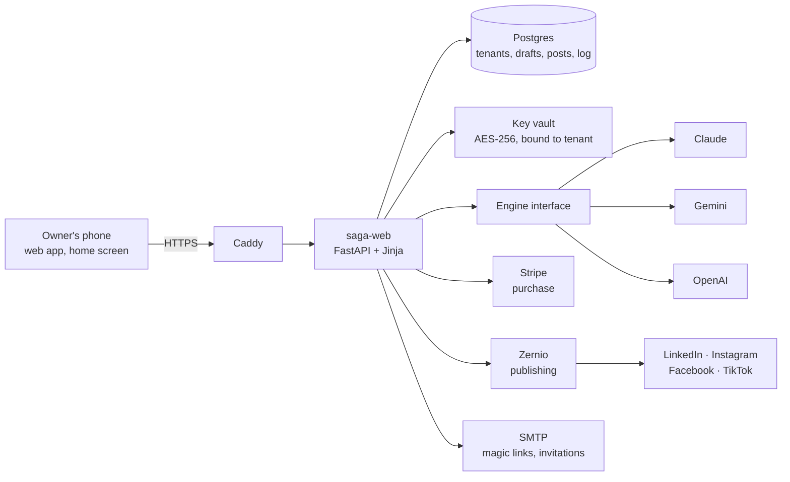
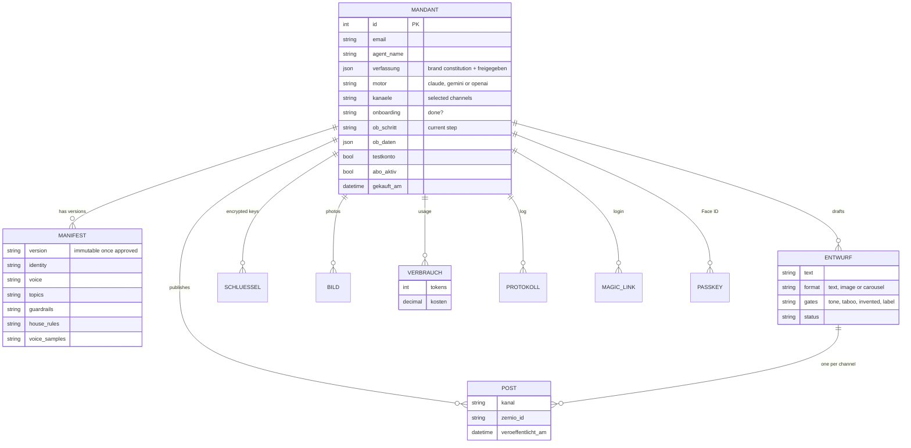
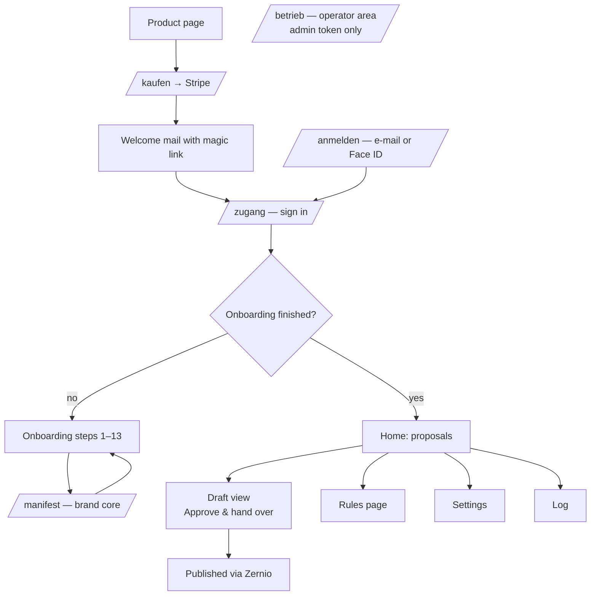

# 03 · Design Pack — SAGA-AGENT

*Competency: Design communication — communicate the design through data models, screen
maps and prototypes, and use the client's feedback to shape it before building.*

## 1. Architecture at a glance

**Key design decision — one engine interface, one JSON schema.** All three AI models
answer into the same structured schema. The product does not depend on one provider,
and the owner can bring whichever key they already have.

**Key design decision — writing and checking are separate calls.** After a draft is
written, a *second* model call checks it against four gates (tone, taboo, invented
facts, labelling). The checker sees the same photo as the writer. The AI label is
measured in code, not judged by a model.

## 2. Data model

**The brand constitution ("Verfassung")** is the heart of the data model:
agent name · form of address (du/Sie) · business · what makes it different · audience ·
goal · tone · 3 topic pillars · taboos · own rules · voice samples · `freigegeben` (approved).

Rule: once approved, a constitution/manifest is **never edited in place** — any change
creates version + 1. No model call rewrites the owner's rules.

## 3. Screen map

### Onboarding (baseline, 13 steps)

| # | Step | Design choice |
|---|---|---|
| 1 | Naming ("Taufe") — agent name, du/Sie | Emotional start: "your own agent" |
| 2 | Business | |
| 3 | Brand core | Separate `/manifest` flow; can be distilled from uploaded documents |
| 4 | Audience | 4 proposals to tick (Client 08.09) |
| 5 | Topics & tone | Proposals to tick |
| 6 | Colours | 4 colours or a palette; colours are never invented |
| 7 | **Approve constitution** | The gate for M4 |
| 8 | Photos | Optional (Client 08.09) |
| 9 | Channels | 2 included |
| 10 | Connect Zernio | |
| 11 | AI key | Last, not first (Client 08.09); Gemini requires EEA confirmation |
| 12 | Add to phone | Home screen + Face ID |
| 13 | Handover | |

## 4. Prototype and how client feedback shaped it

The design was tested in a **live test evening with a real user** (persona *Chris*) before
it was finalised. Findings and the resulting design changes:

| Feedback | Design change |
|---|---|
| "The Gemini key isn't being accepted" | Each AI engine got its own key slot (one shared slot caused a confusing 401) |
| "I have to change this rule — how?" | New **Rules page** (S3) |
| "I want to store my own writing instructions" | Own rules stored as hard rules in the constitution |
| "Always work with paragraphs" | Became a house rule for posts |
| Greeting used the full company name | Short first-name greeting (S6) |
| Onboarding text said "then set your password" | Removed — SAGA has no password; replaced by Face ID |
| Approval tick moved on, but nothing was approved | Approval now happens *inside* the flow (fixes M4 in practice) |

## 5. Visual design

- Mobile-first, one column, large tap targets.
- Brand colours of each tenant flow into carousels; colour comes from the CI document first,
  then the logo, then a neutral house colour. Grey is rejected as a brand colour.
- Contrast is measured: a highlight colour that is too light on white (e.g. 1.27 : 1)
  is automatically darkened for light backgrounds.

## 6. Edge cases designed in (preview for the Showcase)

- Tenant without an approved constitution asks for a draft → refused with an explanation.
- Login with an unknown e-mail → same message as a known one.
- Magic link clicked twice / after 30 minutes → rejected.
- Same draft sent to the same channel twice → blocked.
- Publishing times out → treated as "unknown", not "failed"; the system checks back
  with Zernio before retrying (prevents double posts).
